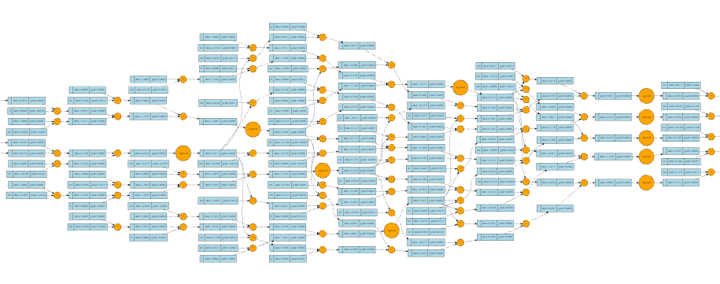

# ScalarFlow



ScalarFlow is a small neural network library implemented from scratch in Python. It pairs a custom reverse-mode autograd engine with a minimal set of neural network building blocks, and can render computation graphs with Graphviz so you can inspect values and gradients.

The goal is clarity rather than speed: everything is built on a single scalar `value` type, which makes the mechanics of backpropagation easy to follow.

## Features

- A scalar autograd engine (`value`) with operator overloading and reverse-mode differentiation.
- Arithmetic operations: addition, subtraction, multiplication, division, powers and `exp`.
- Activation functions: `tanh`, `relu` and `sigmoid`.
- Building blocks: `neuron`, `layer` and `network`.
- Losses: mean squared error (`mse_loss`) and an SVM max-margin loss (`svm_loss`).
- A training loop (`network.fit`) using gradient descent with a decaying learning rate.
- Computation-graph visualisation via Graphviz (`value.draw_graph`).

## Project structure

```
scalarflow/engine.py   # The `value` autograd primitive
scalarflow/nn.py       # neuron, layer, network, losses and training
scalarflow/__init__.py # Re-exports the engine and nn submodules
building_scalarflow.ipynb  # Step-by-step build-up of the library
testing_sclarflow.ipynb    # Sanity tests and training demo
README.md
```

## Dependencies

- Python (>= 3.6)
- `graphviz` (the Python package) and the Graphviz system binaries, for visualisation
- `numpy`, used by the SVM loss for batch sampling

On many systems the Graphviz binaries are installed separately from the Python package, for example:

```bash
# Debian/Ubuntu
sudo apt-get install graphviz
# macOS
brew install graphviz
```

Then install the Python dependencies:

```bash
pip install graphviz numpy
```

There is no packaging metadata, so run examples from the repository root (where the `scalarflow` package lives) or add that directory to `PYTHONPATH`.

## Usage

### Autograd engine

```python
from scalarflow.engine import value

a = value(2)
b = value(3)

c = a + b
d = a * b

d.backward()

print("c =", c)  # c = value(data = 5, grad = 1)
print("d =", d)  # d = value(data = 6, grad = 2)
```

`backward()` performs a topological sort over the graph and applies the chain rule in reverse order, accumulating gradients on each node.

### Neural networks

```python
from scalarflow.nn import network

model = network(num_in=2, layer_sizes=[4, 2, 1], unit_activation='relu')
model.summary()

inputs = [[0, 0], [0, 1], [1, 0], [1, 1]]
outputs = [[0], [1], [1], [0]]

model.fit(inputs, outputs, epochs=100)

predictions = model.predict(inputs)
print(predictions)
```

`unit_activation` accepts `'sigmoid'`, `'tanh'` or `'relu'`; if omitted or unrecognised, units fall back to `tanh`.

### API overview

- `value(data, label='')` — scalar node; exposes `.data`, `.gradient`, `.label` and `.backward()`.
- `value.draw_graph()` — returns a Graphviz `Digraph` of the node's computation graph, annotated with data and gradients. Call `.render()` or display it in a notebook.
- `neuron(num_in, _activation='')` — a single unit with weights and a bias.
- `layer(num_in, num_out, _activation='')` — a dense layer of neurons.
- `network(num_in, layer_sizes, unit_activation='')` — a stack of layers; supports `parameters()`, `zero_grad()`, `summary()`, `mse_loss()`, `svm_loss()`, `fit()` and `predict()`.

### Losses and training

- `model.mse_loss(x, y)` returns the mean squared error plus a small L2 regularisation term.
- `model.svm_loss(x, y, batch_size=None)` computes a max-margin loss with L2 regularisation and also returns accuracy. Passing `batch_size` samples that many rows per call.
- `model.fit(x, y, epochs)` minimises the MSE loss with gradient descent, shrinking the step size over time, and logs the loss every 10 epochs.

Because the engine is scalar-based, these implementations are intended for small datasets and learning purposes.

## Notebooks

- `building_scalarflow.ipynb` develops the engine and network pieces incrementally.
- `testing_sclarflow.ipynb` exercises the library on a tiny dataset, trains a model and plots results.
